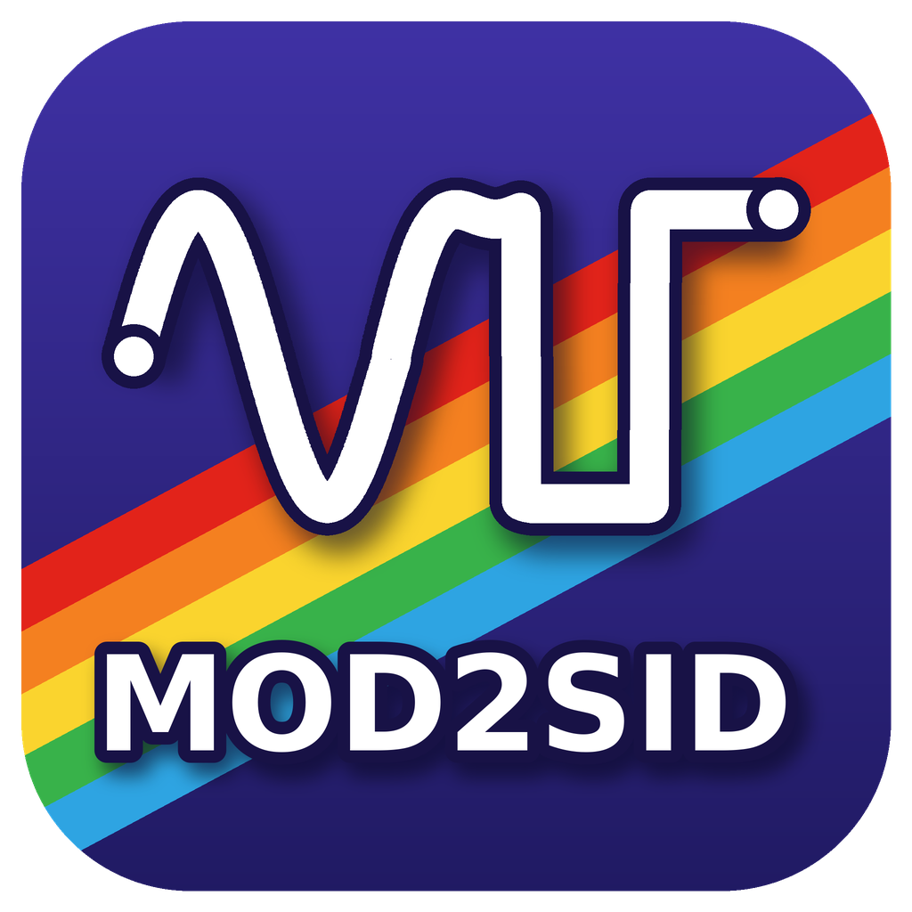

<p align="center"></p>

# mod2sid

**Tracker-Module → C64-SID + GoatTracker/GrooveGoat** – MOD, OctaMED, XM, IT, DigiBooster und Art Of Noise auf 1 bis 8 SIDs, mit KI-Sample-Erkennung, Instrumenten-Bibliothek, Vorhören und Instrumententausch.
App für **macOS (Apple Silicon + Intel), Windows und Linux (AppImage/deb)**, Oberfläche Deutsch/Englisch. *Done by IT-DUMMKOPFEN.*

[English below](#english)

---

## Funktionen

- **Viele Tracker-Formate einlesen**:
  - ProTracker, NoiseTracker, StarTrekker und SoundTracker (M.K., M!K!, FLT4, 4CHN, 6CHN, 8CHN … bis 32 Kanäle, 15-Sample-MODs)
  - **OctaMED / MED** (MMD0, MMD1, MMD2, MMD3) inklusive Synth- und Hybrid-Instrumenten und BPM-Modus
  - **FastTracker 2 XM** (Instrumente mit mehreren Samples, Lautstärke-Hüllkurven, Volume-Spalte, lineare Frequenzen)
  - **Impulse Tracker IT** (Instrumente, Hüllkurven, gepackte IT-2.14/2.15-Samples)
  - **DigiBooster Pro DBM** und **Art Of Noise** (AON4 und AON8, mit Synth-Wellenformen und Profi-Arpeggios)
  - mit PowerPacker (PP20) gepackte Dateien werden automatisch entpackt

  Alle Formate laufen über einen gemeinsamen, tickgenauen Replayer: Arpeggio, Portamento, Tone-Portamento, Vibrato, Tremolo, Lautstärke, Hüllkurven, Key-off, Pattern-Break/-Jump, Loops, Delays und Retrigger.
- **KI-Erkennung der Samples**: Ein trainierter Klassifizierer (Extra-Trees-Ensemble) erkennt 20 Klassen: Bassdrum, Snare, HiHat, Becken, Tom, Perkussion, **Drum-Loop**, Bass, Lead, Fläche, Streicher, Blech, Holzbläser, Gitarre, Tasten, Glocke, Chor, Akkord, Effekt und **Stimme**. Grundlage sind 34 Klang- und Nutzungsmerkmale: Spektrum, Hüllkurve, Tonhöhe (YIN), Akkord-Chroma, Anschläge (Onsets) und wie das Sample im Song gespielt wird.
- **Drum-Loops zerlegen**: Ein Sample mit einem ganzen Beat wird in einzelne Schläge zerlegt. Jeder Schlag wird als Bassdrum, Snare, HiHat, Becken, Tom oder Perkussion eingeordnet; gleich klingende Schläge werden zusammengefasst und teilen sich ein SID-Instrument. Der Beat läuft dann zeilengenau mit verschiedenen SID-Drums.
- **Menschliche Stimmen** (Sprache, Gesang) erkennt die KI am Klang und lässt sie weg. Wer sie trotzdem hören will, wählt beim Sample „Stimme mit Tonverlauf (KI)“. Dann wird die Tonhöhe alle 20 ms gemessen und als Wavetable nachgebaut.
- **Klang-Optionen**:
  - Slides: Original, Sanft (nur Gleiten zwischen Noten, keine Rutscher auf Drums) oder Aus
  - Vibrato: Original, Dezent oder Aus
  - „Wellenform am Klang anpassen“: Das Obertonspektrum jedes Samples wird mit Dreieck, Sägezahn und Rechteck verschiedener Pulsbreiten verglichen.
  - „Keine Drums“
  - „2 Stimmen“: 1 SID ohne Drums, Stimme 3 bleibt frei, z. B. für Soundeffekte in einem Spiel
- **Lange Streicher und Flächen** behalten ihr langsames Anschwellen und klingen so lange wie das Original-Sample, mit einem Release wie der Ausklang des Samples.
- **Instrumente nachbauen**: Bibliothek mit 166 SID-Instrumenten in 17 Kategorien (Bass, Lead, Streicher, Blech, Holz, Gitarre, Tasten, Glocken, Flächen, Chor, Synth, Drums, KI-Automatik, Welt/Ethno, Chiptune, Effekte). Die Hüllkurve (ADSR) wird an das Original-Sample angepasst, Akkord-Samples werden zu Arpeggios.
- **1, 2, 4, 6 oder 8 SIDs** (3 bis 24 Stimmen), „Auto“ wählt passend zur Kanalzahl. Freie Stimmen spielen Akkord-Samples als echte Akkorde und übernehmen Drum-Schläge, damit Bass oder Melodie weiterklingen. Hat ein Modul mehr Kanäle als Stimmen, legt der Arranger Kanäle zusammen oder lässt die leisesten weg.
  - 1 SID: `.sid` (PSID v2) + `.sng` für **GoatTracker 2**
  - 2 SIDs: `.sid` (PSID v3, zweiter SID auf $D420) + `.sng` für **GoatTracker Stereo**
  - 4, 6 oder 8 SIDs: `.sid` (PSID v5) + `.ggt` für **C64 GrooveGoat**. SIDs liegen ab $D400 in Schritten von $20. 6 SIDs werden als 8-SID-Song gespeichert, SID 7 und 8 bleiben still.
  - Die Patterns werden für jede Stimme einzeln geschnitten, damit sich wiederholende Takte geteilt werden. GoatTracker und GrooveGoat erlauben höchstens 208 Patterns: Passt ein Stück mit vielen Stimmen nicht hinein, wird es gekürzt und die App meldet es.
- **Mehr Kanäle als Stimmen**: Der Arranger bewertet für jedes Pattern, welche Kanäle zusammengelegt oder weggelassen werden, und nutzt C64-Tricks:
  - Drum-Anschlag + Bass/Melodie auf einer Stimme (Rausch-Transient vorne, dann die Note)
  - Drum-Transient über einen gehaltenen Ton, ohne ihn neu anzuschlagen
  - zwei Melodiestimmen als Arpeggio
  - Lücken füllen und Melodie nach einem Drum-Schlag fortsetzen
- **Vorhören** mit eingebautem 6502- und SID-Emulator (6581/8580), A/B-Vergleich mit dem Original-Modul, Stimmen stumm/solo, Lautstärkeregler, Oszilloskop.
- **Instrumente tauschen**: Die Änderung wird sofort neu berechnet. Die App **lernt** deine Wahl und schlägt sie bei ähnlichen Samples künftig vor.
- **Neu konvertieren**: Jedes Mal entsteht eine andere Variante (Instrumentwahl und Stimmenverteilung); der Kreativitätsregler steuert, wie stark sie sich unterscheidet.
- **Speichern**: `.sid` (eigener GoatTracker-kompatibler Player ab $1000; läuft in VICE, SIDPlay und auf echten C64) **und** `.sng` (GoatTracker) bzw. `.ggt` (C64 GrooveGoat) zum Weiterbearbeiten.
- **Synth-Instrumente** aus OctaMED und Art Of Noise: Ihre Wellenform (Rechteck mit Pulsbreite, Sägezahn oder Dreieck) wird erkannt und direkt für das SID-Instrument verwendet.

## Installation

Downloads unter [Releases](https://github.com/IT-DUMMKOPFEN/mod2sid/releases) bzw. in den [Actions-Artefakten](https://github.com/IT-DUMMKOPFEN/mod2sid/actions):

| System | Datei |
|---|---|
| macOS Apple Silicon | `mod2sid-…-mac-arm64.dmg` |
| macOS Intel | `mod2sid-…-mac-x64.dmg` |
| Windows 10/11 | `mod2sid-…-win-x64-setup.exe` (Installer) oder `…-portable.exe` |
| Linux | `mod2sid-…-linux-x86_64.AppImage` (ausführbar machen: `chmod +x`) oder `…-linux-amd64.deb` |

Die Programme sind nicht signiert:
- **macOS:** beim ersten Start Rechtsklick → Öffnen, oder `xattr -cr /Applications/mod2sid.app`
- **Windows:** bei der SmartScreen-Warnung „Weitere Informationen“ → „Trotzdem ausführen“

## Selbst bauen

```bash
npm install
npm start              # App starten
npm run dist:mac       # macOS arm64 + x64 (auf einem Mac)
npm run dist:win       # Windows Installer + Portable
npm run dist:linux     # AppImage + deb
node tools/test/selftest.mjs            # Kern-Selbsttest
node tools/test/run_all.mjs <ordner>    # alle MODs eines Ordners testen
```

GitHub Actions (`.github/workflows/build.yml`) baut bei jedem Push auf `main` für macOS (arm64 + x64), Windows und Linux; ein Tag `v*` erstellt ein Release mit allen Dateien.

## KI-Training

Die Werkzeuge liegen in `tools/train/`:

1. `synth_dataset.py` erzeugt einen synthetischen Datensatz typischer Amiga-Samples (20 Klassen inkl. Drum-Loops, mit Varianten von Klangfarbe, Hüllkurve, Samplerate und Spielweise).
2. `extract.mjs` berechnet die Merkmale mit **demselben Code wie die App** (`src/core/features.js`) – für die synthetischen Samples und für die von Hand beschrifteten echten Samples aus `labels.json`.
3. `extract_wav.mjs` liest eine Sample-Bibliothek (WAV). Beschriftet wird nach dem Dateinamen (`wavlabel.mjs`), aber nur, wenn der Klang dazu passt. Die meisten Amiga-WAVs tragen einen falschen 44,1-kHz-Header; sie werden mit typischen MOD-Abspielraten (8–17 kHz) als 8-Bit-Samples ausgewertet.
4. `train.py` trainiert das Extra-Trees-Modell, prüft es per *Leave-one-MOD-out* (das geprüfte MOD ist nie im Training) und exportiert `src/core/model.json`.

Stand v2.1.3: 6 000 synthetische Samples, 5 304 Samples aus der WAV-Bibliothek und 129 799 echte Samples aus 33 617 Modulen. Darin stecken unter anderem 11 524 MODs von sechs CD-Images, 1 467 Module in den neuen Formaten (OctaMED, XM, IT, DigiBooster, Art Of Noise), 586 Module aus ModsUpdate2020 und 17 426 Module aus einer weiteren großen MOD-Sammlung. Die Beschriftung stammt aus `autolabel.mjs`: Namen wie „st-01:bass“ zählen nur, wenn Klang und Spielweise dazu passen, dazu kommen eindeutige Klangregeln. Die KI selbst sieht keine Namen. Sie lernt nur aus Klang- und Spielmerkmalen und ordnet damit auch Samples ohne sinnvollen Namen ein. Ergebnisse (reine Klang-Einordnung, ohne Namen):
- Module, die nie im Training waren: **86 % exakte Klasse, 93 % richtige Familie** (Drum / Bass / Melodie / Akkord / FX / Stimme / Beat), gemessen mit 10-fach gruppierter Kreuzvalidierung.
- Zurückgehaltene WAV-Samples: **65 % Klasse / 87 % Familie**.

Für große Sammlungen gibt es `labelfeat.mjs`. Es beschriftet die Samples und berechnet die Merkmale in einem Durchgang. Der Lauf kann in Zeitscheiben und parallel auf mehreren Kernen erfolgen und lässt sich jederzeit fortsetzen.

Was die KI falsch einordnet, korrigierst du per Instrumententausch, und die App merkt es sich.

```bash
python3 tools/train/synth_dataset.py /tmp/synth 300
node tools/train/autolabel.mjs <neue-mods> tools/train/labels_auto.json
node tools/train/extract.mjs /tmp/synth <mod-ordner1>,<mod-ordner2> /tmp/features.json
node tools/train/extract_wav.mjs <wav-ordner> /tmp/wav.json
AUG=3 WAVREP=4 NTREES=50 LEAF=4 python3 tools/train/train.py /tmp/features.json src/core/model.json /tmp/wav.json
```

## Technik

| Teil | Datei |
|---|---|
| Gemeinsames Songmodell, Replayer, Vorschau | `src/core/song.js` |
| Lader MOD / XM / IT / OctaMED / DigiBooster / Art Of Noise | `src/core/mod.js`, `src/core/formats/` |
| Merkmale, Tonhöhe, Akkorde, Onsets | `src/core/features.js` |
| Drum-Loop-Zerlegung, Stimmen-Tonverlauf | `src/core/beat.js` |
| KI-Klassifizierer (Inferenz) | `src/core/classifier.js`, `model.json` |
| Instrumenten-Bibliothek | `src/core/library.js` |
| Arranger (Kanäle → 3–24 Stimmen), Effekte | `src/core/arrange.js` |
| GoatTracker-Songmodell, SNG und GrooveGoat-GGT | `src/core/gtsong.js` |
| 6502-Player (GoatTracker-kompatibel) | `src/core/player.js` |
| Assembler / 6502-CPU / SID-Emulation | `src/core/asm6502.js`, `cpu6502.js`, `sid.js` |
| PSID-Erzeugung | `src/core/sidbuild.js` |
| Electron-App | `src/main/`, `src/renderer/` |

**Grenzen:** Der SID hat keine Lautstärke pro Stimme. Lautstärke-Effekte laufen über das Sustain-Level. Die SID nutzt einen eigenen Player mit GoatTracker-2-Semantik. Für die Original-GoatTracker-Routine öffnest du die `.sng` in GoatTracker und packst sie dort.

## Lizenz

GPL-3.0 – siehe [LICENSE](LICENSE). Das SNG-Format stammt von GoatTracker 2 (Lasse Öörni / Cadaver).

---

## English

**mod2sid** converts tracker modules – ProTracker MOD (4–32 channels), **OctaMED** (MMD0–3), **FastTracker 2 XM**, **Impulse Tracker IT**, **DigiBooster Pro DBM** and **Art Of Noise** (AON4/AON8), also PowerPacker-packed – into **C64 SID music (PSID)** on **1, 2, 4, 6 or 8 SIDs**, plus **GoatTracker** (.sng) or **C64 GrooveGoat** (.ggt) songs. It is an Electron app for **macOS (Apple Silicon + Intel), Windows and Linux (AppImage/deb)** with a German/English interface.

- An **AI classifier** (extra-trees, trained on synthetic and hand-labelled real Amiga samples) recognises 20 instrument classes, including drum loops and voices. It was trained on synthetic samples, a library of more than 5 000 Amiga WAV samples and about 54 000 labelled samples from 14 306 MODs. On MODs it never saw it gets 85 % of classes and 92 % of families right.
- **Drum loops** are split into single hits. Similar hits are clustered and share one SID drum, so kick, snare and hi-hat in a loop become different instruments.
- **Human voices** are recognised by their sound and left out (they can still be switched to “voice with pitch contour”).
- **Sound options**: slides (original / soft / off), vibrato (original / subtle / off), “match waveform to the sound” (overtone spectrum → triangle, saw or pulse width), “no drums”, and “2 voices” (1 SID without drums, voice 3 free).
- **Long strings/pads** keep their swell and ring for the full sample length.
- **1 to 8 SIDs** (3 to 24 voices), “Auto” picks enough for the channels. 1 SID: PSID v2 + GoatTracker 2 .sng; 2 SIDs: PSID v3 + GoatTracker Stereo .sng; 4, 6 or 8 SIDs: PSID v5 + C64 GrooveGoat .ggt (SIDs from $D400 in steps of $20; 6 SIDs are stored as an 8-SID song). Patterns are cut per voice so repeated bars are shared; songs that do not fit into the 208 patterns are shortened.
- **Synth instruments** of OctaMED and Art Of Noise keep their waveform (pulse with its width, saw or triangle).
- **Instrument library** with 166 SID instruments. Envelopes are fitted to the original samples, and chord samples become arpeggios.
- An **arranger for 4 → 3 voices** uses classic C64 tricks: combined bass and drum notes, drum transients overlaid on held notes, arpeggio merging and gap filling.
- **Preview** with a built-in 6502 + SID emulator (6581/8580), A/B comparison with the original module, mute/solo for each voice, volume slider.
- **Swap instruments** to re-convert instantly; the app learns your choices. **Convert again** produces a different variant.
- **Save** writes a `.sid` (own GoatTracker-compatible player at $1000) and a `.sng` (GoatTracker) or `.ggt` (C64 GrooveGoat).

Installation: download the DMG from Releases/Actions, drag the app to Applications, and open it the first time with right-click → Open. If macOS says the app is damaged, run `xattr -cr /Applications/mod2sid.app`.
